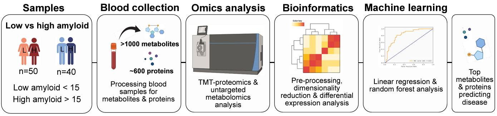
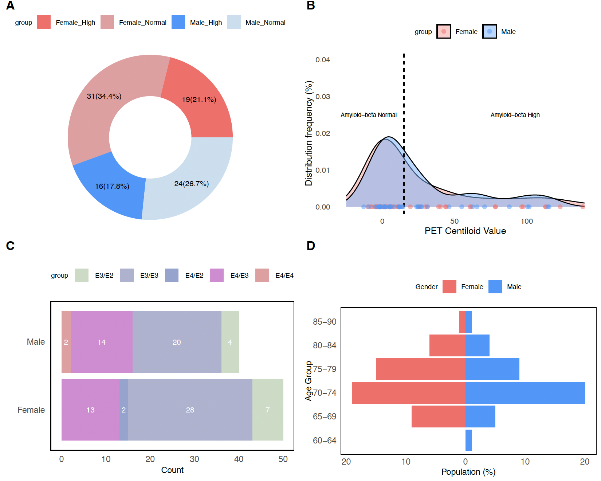
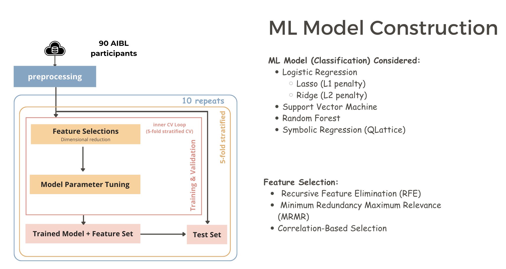

# Exploring a novel panel of multi-omic blood biomarkers for preclinical Alzheimer’s disease with the Australian Imaging, Biomarker and Lifestyle (AIBL) cohort

This is the official repository accompanying the paper **Exploring a novel panel of multi-omic blood biomarkers for preclinical Alzheimer’s disease with the Australian Imaging, Biomarker and Lifestyle (AIBL) cohort**

**Authors:**

Yihan Wang, Alanna G. Spiteri, Katherine Jeppe, Joel R. Steele, Christopher K. Barlow, Ralf Schittenhelm, Colin L. Masters, Benjamin Goudey, Liang Jin, Yijun Pan, and the AIBL Research Group

## Overview
We utilized data from 90 participants in the AIBL cohort, all of whom had completed the ORCA (Online Repeatable Cognitive Assessment) learning test. The study incorporated *proteomics* data consisting of 596 high/mid-confidence features, as well as *metabolomics* data with 1,345 peak intensity features. Additionally, *demographic* factors such as age, gender, education, and APOE4 status (yes/no) were included in the analysis. The primary aims of the study were twofold: first, to use minimally invasive data to predict amyloid-beta status (high vs. normal) based on PET imaging; and second, to identify potential biomarkers that can distinguish participants in the preclinical phase of Alzheimer's disease.

## General pipeline

## Overall Data Description

## ML construction pipeline

## Acknowledgements
The study received support from National Health and Medical Research Council, Australia (GNT2007912), Alzheimer’s Association, USA (23AARF-1020292), and Bethlehem Griffiths Research Foundation (BGRF2306).

## Data Sharing Statement
The data used in this study are derived from the Australian Imaging, Biomarkers, and Lifestyle (AIBL) dataset, which is subject to specific access conditions. Due to these restrictions, we are unable to share the data directly.

## File Description
- [ML_code](/ML_code): The code for ML model construction
    - [preprocessing](/ML_code/preprocessing.ipynb): merge proteomics and metabolomics and different version of data construction (e.g. with omics data only, merge with demogrphic, impute for missing)
    - [plots-R](/ML_code/plots.Rmd): gives basic statistic plots (e.g. population pyramid)
    - [plots-python](/ML_code/plots.ipynb): gives several basic statistic info and plots (e.g. PCA elbow plots, volcano plots, heatmap, violin plot for top features)
    - [model-evaluation](/ML_code/Model-evaluation-IQR.ipynb): ML model construction and evaluation for data given (only the LR related model provided).
- [results](/results): The saved ML model results
- [plots](/plots): Store several plots results for ML models.

## Environment required
- python environment: 3.11
- statannotations: 0.5.0
- Seaborn: 0.11.2
- sklearn: 1.3.1
- Feyn (Qlattice): 3.2.0
    - Abzu document: https://docs.abzu.ai/ 
    - QLattice: use `pip3 install feyn`
- mRMR: 
    - mRMR document: https://github.com/smazzanti/mrmr
    - install: `pip install mrmr_selection`

